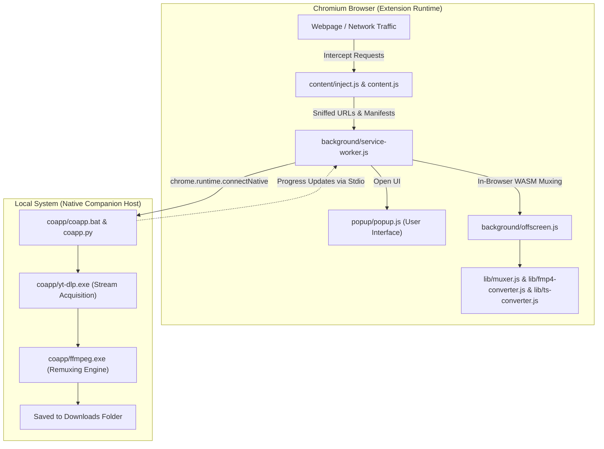

<div align="center">
  
  <h1>MediaSniff</h1>
  <p><strong>Advanced Media Sniffer & High-Resolution Stream Downloader for Chrome & Chromium Browsers</strong></p>
  <p>Seamlessly intercept, parse, mux, and download HLS, DASH, fMP4, and 4K streaming media with in-browser WebAssembly and native companion app acceleration.</p>
</div>

<br />

## 📖 What is MediaSniff?

Most modern streaming platforms (YouTube, Twitter/X, Instagram, Vimeo, and video portals) no longer serve videos as plain `.mp4` links. Instead, video and audio are split into separate tracks, sliced into hundreds of encrypted or fragmented chunks (HLS `.m3u8`, DASH `.mpd`, or `.m4s`), and protected by anti-bot checks or CORS restrictions.

**MediaSniff** provides a comprehensive, dual-engine solution:
1. **In-Browser WebAssembly Engine:** Intercepts media traffic, downloads video and audio segments concurrently with an asynchronous worker pool, and muxes them directly inside your browser memory into standard ISO BMFF `.mp4` files.
2. **Native Companion App Engine (`coapp`):** Automatically routes high-resolution (1080p / 4K / 2160p) YouTube streams to a bundled, lightweight native host (`yt-dlp` + `ffmpeg`) via Chrome's Native Messaging API, completely eliminating HTTP 403 Forbidden errors and CORS limitations.

---

## 🌟 Key Features

* **Universal Protocol Support:** Automatically sniffs, reconstructs, and downloads:
  - **HLS (HTTP Live Streaming):** Master playlists, variant renditions, MPEG-TS, and fragmented MP4 (fMP4) chunks.
  - **DASH (Dynamic Adaptive Streaming over HTTP):** Video + audio adaptation sets.
  - **Direct MP4 / WebM / Progressive streams.**
* **Dual-Engine Architecture:**
  - **In-Browser WASM Muxer:** Uses ISO BMFF box manipulation and TS demuxing for Twitter/X, Instagram, Vimeo, and web streams.
  - **Native Companion App (`yt-dlp` + `ffmpeg`):** Provides 100% reliable 1080p and 4K (2160p) downloads on platforms with strict anti-bot protections (like YouTube).
* **Live Progress & Speed Metrics:** Real-time percentage updates, download speeds, and step-by-step pipeline status directly in the extension popup.
* **Auto-Subtitles & Metadata:** Automatically discovers and downloads multi-language subtitle tracks (`.vtt`), strips duplicate headers, and grabs high-resolution video thumbnails.
* **Stream to Disk (File System API):** Write chunks directly to local storage to minimize memory consumption during long video downloads.
* **Zero Cloud Dependency:** Runs entirely on your local machine—no remote tracking servers, third-party proxies, or external cloud processing.

---

## 🎮 How to Use

1. **Pin the Extension:** Pin the MediaSniff icon to your browser toolbar.
2. **Navigate & Play:** Visit any website with media (e.g. YouTube, Twitter/X, Instagram, Vimeo). Start playing the video to trigger network requests.
3. **Open MediaSniff:** Click the MediaSniff icon in your toolbar.
4. **Choose Quality & Track:**
   - Select your target video quality (e.g. `2160p (4K)`, `1080p`, `720p`).
   - Select your desired audio track (AAC or Opus).
5. **Download:**
   - Click **Download** to start downloading. YouTube items automatically utilize the companion app and save directly to your **Downloads** folder (`C:\Users\<user>\Downloads`).
   - Click **Mux** to combine separate video and audio tracks in-browser using WebAssembly.
   - Click **Stream to Disk** for memory-efficient streaming directly to your hard drive.

---

## 🚀 Installation & Setup

### 1. Load the Browser Extension
1. Clone or download this repository:
   ```bash
   git clone https://github.com/your-username/mediasniff.git
   ```
2. In Google Chrome, Microsoft Edge, Brave, or Chromium, open:
   `chrome://extensions/`
3. Toggle **Developer mode** on (top-right corner).
4. Click **Load unpacked** and select the `mediasniff` root folder.
5. Note your extension ID (or let the installer auto-detect it).

### 2. Register the Native Companion App (One-Time Setup)
For 1080p & 4K YouTube downloads, run the automated installer script:

**On Windows (PowerShell):**
```powershell
powershell -ExecutionPolicy Bypass -File coapp\install_coapp.ps1
```

The script will:
- Detect your installed Chrome / Edge / Brave profiles and extension ID.
- Configure `coapp/net.mediasniff.coapp.json` with the required `allowed_origins`.
- Register the `net.mediasniff.coapp` native messaging host in the Windows Registry (`HKCU:\Software\Google\Chrome\NativeMessagingHosts`).
- Verify the bundled `yt-dlp.exe` and `ffmpeg.exe` binaries.

---

## 🏗️ Technical Architecture



### Module Overview

| Component | File Path | Functionality |
| :--- | :--- | :--- |
| **Service Worker** | `background/service-worker.js` | Media registry, network request interception, route orchestration (Native vs. WASM). |
| **Offscreen Engine** | `background/offscreen.js` | Sandboxed environment executing CPU-intensive audio/video segment assembly and WASM muxing. |
| **FMP4 Converter** | `lib/fmp4-converter.js` | Parses ISO BMFF atoms (`moov`, `moof`, `traf`, `trun`, `mdat`) and reconstructs clean non-fragmented MP4 files. |
| **MPEG-TS Converter**| `lib/ts-converter.js` | Demuxes MPEG-TS transport packets, synchronizes PES video/audio streams, and generates standard MP4 containers. |
| **WASM Muxer** | `lib/muxer.js` | High-performance WebAssembly remuxer supporting multi-track interleaving and container validation. |
| **Companion App** | `coapp/coapp.py` | Native messaging host wrapping `yt-dlp` and `ffmpeg` with cookie jar delegation and real-time progress callbacks. |

---

## 🛠️ Troubleshooting

* **YouTube shows HTTP 403 or Video Stream Error:**
  - Ensure the companion app is installed by running `coapp\install_coapp.ps1`.
  - Reload the extension in `chrome://extensions/`.
* **Twitter/X Video Fails to Mux:**
  - Make sure the video has played for at least 1-2 seconds on the page before clicking Download so all initial variant playlists are sniffed.
* **Companion App Not Found:**
  - Verify that `HKCU:\Software\Google\Chrome\NativeMessagingHosts\net.mediasniff.coapp` exists in the Windows Registry pointing to `coapp\net.mediasniff.coapp.json`.

---

## 📄 License

Distributed under the MIT License. See `LICENSE` for more information.
